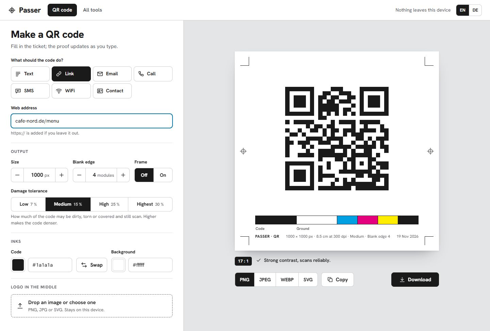
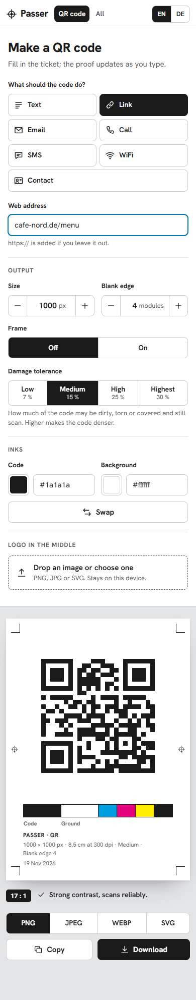
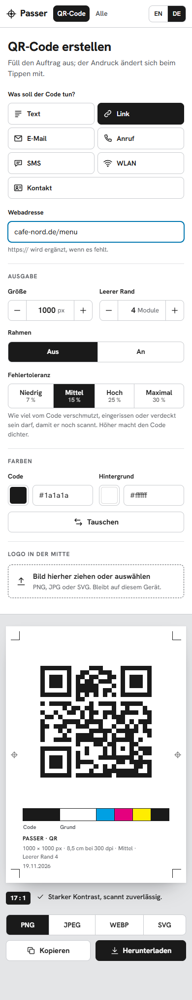
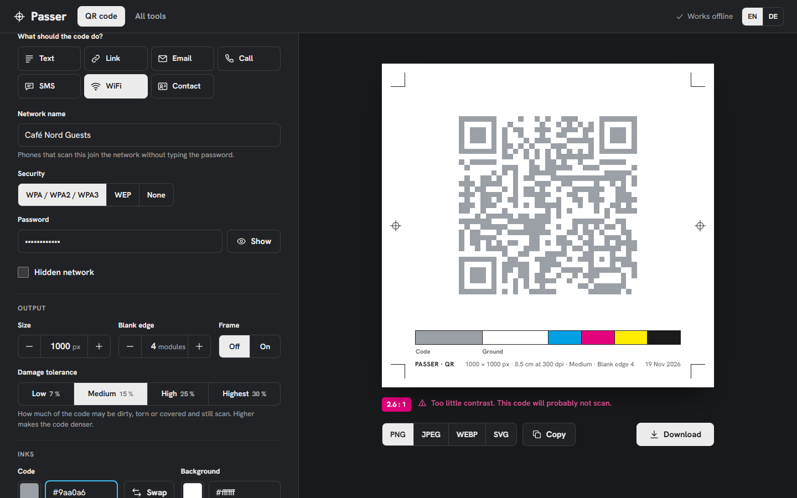

# Passer

**Small tools that work on your device, even offline.** Passer is a growing collection of everyday web tools. Everything runs in the browser: nothing you type or upload is sent anywhere, it installs like an app, and after the first visit it works without a network.

The name comes from print: *Passer* is the German word for registration, the moment the inks line up exactly. The interface is a print shop's proof: you fill in the job ticket on the left, and the result sits on a registered proof sheet on the right, with crop marks, a colour control strip and a slug line.



<table>
  <tr>
    <td width="50%" align="center"></td>
    <td width="50%" align="center"></td>
  </tr>
  <tr>
    <td><b>On a phone.</b> The form comes first and the proof follows, with the export buttons under it.</td>
    <td><b>Deutsch.</b> The app follows the device language; EN / DE switches it in the header.</td>
  </tr>
</table>



<sub>Dark mode keeps the proof on white paper. Here the code colour is too light, and the contrast check says so before you download it. All screenshots are of the real app.</sub>

## Tools

**QR code** (`/qr/`)
- Content types: text, link, email, call, SMS, WiFi login, contact card (vCard 3.0)
- Size in px, blank edge (quiet zone) in modules, optional frame
- Damage tolerance (error correction L / M / Q / H) explained in plain words
- Code and background colour with swap, and a live contrast check that warns before a code becomes unscannable (also for light-on-dark codes)
- Optional logo in the middle (PNG, JPG, SVG); adding one raises the tolerance to Highest
- Export PNG, JPEG, WEBP, SVG; copy to the clipboard; download
- Codes contain the content directly: no redirect service, no expiry

## How it's built

- **Vite + TypeScript + Preact.** Runtime dependencies: `preact` and the self-hosted font. That's it.
- **QR encoder in Rust → WebAssembly** (`wasm/qr`, using the `qrcodegen` crate), with a small raw ABI and no wasm-bindgen. Rust also emits the SVG path with runs merged. The compiled `src/tools/qr/qr.wasm` is committed, so a normal build needs no Rust.
- **Offline** via a hand-written service worker (`build/sw-template.js`). At build time, `build/pwa-plugin.ts` fills in the precache list and a content-hash version, and writes one real HTML page per tool (`dist/qr/index.html`), so deep links work on any static host without rewrites. New versions install in the background; an **Update ready · Reload** button appears in the header.
- **EN / DE**, following the device language, switchable in the header (`src/i18n.ts`).
- Settings persist in `localStorage`. What you type stays in `sessionStorage` (gone when the tab closes); logos are never stored.

```sh
npm install
npm run dev          # http://localhost:5173
npm run build        # → dist/
npm run build:wasm   # rebuild qr.wasm (needs Rust + wasm32-unknown-unknown)
npm run icons        # re-render the PNG app icons
```

Offline mode needs a secure context: test it on `npm run preview` (localhost) or over https.

## Adding a tool

1. Add an entry to `src/tools/catalog.ts` (slug, names, summary in EN and DE). The build creates `dist/<slug>/index.html` and precaches it.
2. Put the tool in `src/tools/<slug>/` and route it in `src/app.tsx`.
3. Strings go into both tables in `src/i18n.ts`.

## Hosting

Static files on all-inkl (Apache). `./deploy.sh` (Git Bash) builds, sends `dist/` as one archive over one SSH connection, swaps it into `<DEPLOY_SSH_PATH>/public` and checks `version.txt`, the wasm MIME type and `/qr/` on the live domain. Settings live in `.env.deploy` (see `.env.deploy.example`). `public/.htaccess` sets https, the wasm MIME type, a strict CSP and cache headers.

## Docs

- [PRODUCT.md](PRODUCT.md): who it is for and why
- [DESIGN.md](DESIGN.md): the visual system

Font: Hanken Grotesk (SIL Open Font License), bundled.
